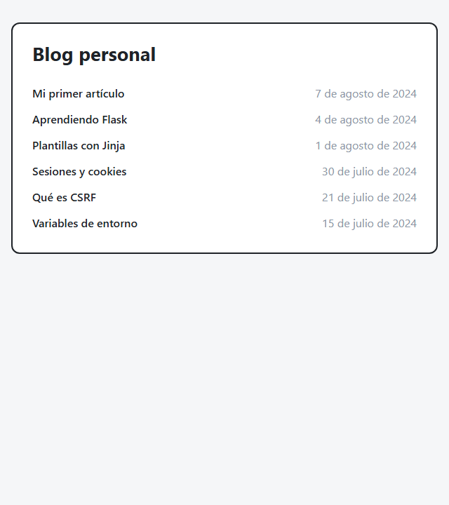
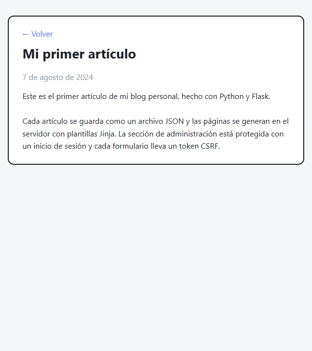
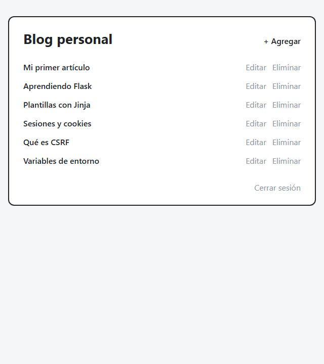
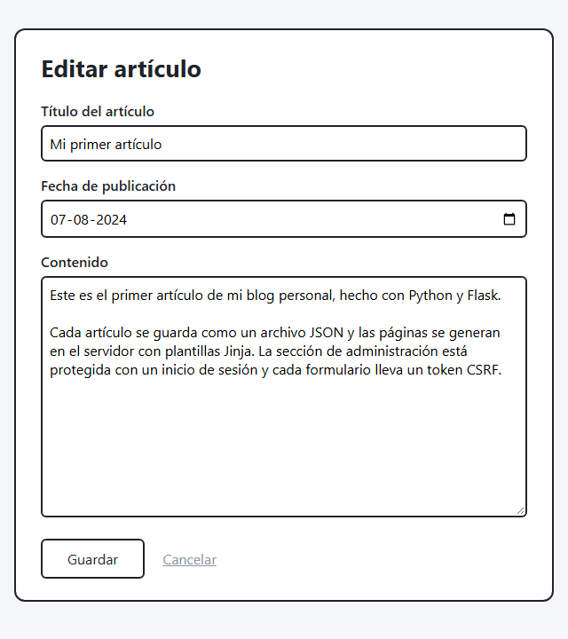

# Blog personal

Blog con una sección pública para leer artículos y una sección de administración, protegida con usuario y contraseña, para publicarlos, editarlos y eliminarlos.
Cada artículo se guarda como un archivo JSON y las páginas se generan en el servidor con plantillas Jinja.

Hecho con Python y **Flask**, como parte del [proyecto Personal Blog de roadmap.sh](https://roadmap.sh/projects/personal-blog).

<p align="center">
  
  
</p>
<p align="center">
  
  
</p>

## Páginas

| Ruta | Acceso | Descripción |
|---|---|---|
| `/home` | Público | Lista de artículos, del más reciente al más antiguo |
| `/article/<id>` | Público | Título, fecha y contenido del artículo |
| `/login` | Público | Inicio de sesión del administrador |
| `/admin` | Administrador | Panel con Editar, Eliminar y + Agregar |
| `/new` | Administrador | Formulario para crear un artículo |
| `/edit/<id>` | Administrador | Formulario para editar un artículo |

## Requisitos

- Python 3 (probado con Python 3.15)

## Instalación

```bash
git clone https://github.com/franciscogdeveloper/Blog-Personal-Web.git
cd Blog-Personal-Web

# Entorno virtual con las dependencias del proyecto
python -m venv .venv
source .venv/Scripts/activate      # Windows (Git Bash)
# source .venv/bin/activate        # Linux / macOS
pip install -r requirements.txt
```

## Configuración

Los secretos no están en el código: se leen de variables de entorno.

| Variable | Descripción |
|---|---|
| `BLOG_SECRET_KEY` | Clave con la que Flask firma la cookie de sesión |
| `BLOG_ADMIN_USER` | Usuario del administrador |
| `BLOG_ADMIN_PASSWORD_HASH` | Hash de la contraseña del administrador (nunca la contraseña en texto plano) |
| `BLOG_ARTICLES_DIR` | Opcional. Carpeta de los artículos (por defecto, `articles/`) |

1. Genera la clave secreta:
   ```bash
   python -c 'import secrets; print(secrets.token_hex(32))'
   ```
2. Genera el hash de tu contraseña (la pide sin mostrarla):
   ```bash
   python -c 'from getpass import getpass; from werkzeug.security import generate_password_hash; print(generate_password_hash(getpass("Contraseña: ")))'
   ```
   > En Git Bash para Windows, antepón `winpty` al comando.
3. Crea un archivo `.env.sh` (ya está en `.gitignore`), con los valores **entre comillas simples** porque el hash contiene `$`:
   ```bash
   export BLOG_SECRET_KEY='...'
   export BLOG_ADMIN_USER='admin'
   export BLOG_ADMIN_PASSWORD_HASH='...'
   ```
   > En Windows, guárdalo con finales de línea **LF**. Si quedan en CRLF, bash agrega un `\r` invisible al hash y el login falla.

## Uso

```bash
source .env.sh
flask --app app run --debug
```

Abre **http://127.0.0.1:5000** para ver el blog y **http://127.0.0.1:5000/login** para administrarlo.

## Seguridad

- **Contraseña:** se guarda solo su hash (`scrypt`, mediante Werkzeug) y se compara con `check_password_hash`. El usuario se compara con `secrets.compare_digest`, que tarda lo mismo sin importar dónde difieran los textos.
- **Sesión:** la cookie está firmada con `BLOG_SECRET_KEY` y usa `SameSite=Lax`. Al iniciar sesión se crea una sesión nueva.
- **CSRF:** cada formulario lleva un token secreto guardado en la sesión, y todo POST sin el token correcto se rechaza con `400`.
- **Eliminar y cerrar sesión** son formularios POST, no enlaces: una petición GET nunca modifica datos.
- **XSS:** Jinja escapa automáticamente todo lo que se muestra, y el contenido se presenta con `white-space: pre-line`, sin interpretar HTML.

## Tests

```bash
python -m unittest -v
```

- `test_articles.py`: validación y almacenamiento (crear, leer, listar ordenado, editar, eliminar y archivo dañado).
- `test_app.py`: páginas públicas, 404, login y logout, rutas protegidas, crear, editar y eliminar, CSRF y escape de HTML. Usa el `test_client` de Flask, credenciales de prueba y una carpeta temporal.

## Estructura del proyecto

```
app.py              # Aplicación Flask: configuración, rutas, CSRF y filtro de fecha
auth.py             # Comprobación de credenciales y decorador @login_required
articles.py         # ArticleStore: un archivo JSON por artículo, con validación
templates/          # Plantillas Jinja (base, portada, artículo, login, panel, formulario y 404)
static/style.css    # Estilos
test_articles.py    # Tests del almacenamiento
test_app.py         # Tests de la aplicación web
requirements.txt    # Dependencias (Flask y las suyas)
```

## Próximas funciones

- [ ] Comentarios
- [ ] Categorías
- [ ] Etiquetas
- [ ] Búsqueda
